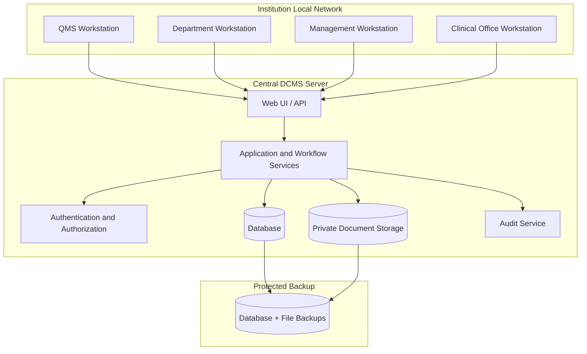

# System Architecture

## 1. Deployment model

Target deployment is a local-network client-server application.

- Client: browser on authorized institutional workstations.
- Application server: authentication, authorization, business logic, workflow engine, API, reports.
- Database server: structured DCMS metadata and workflow state.
- File storage: private server-side storage for uploaded documents and evidence.
- Backup target: separate protected storage for database and files.

Core operations must not depend on internet availability.

## 2. Logical application layers

1. Presentation layer — dashboards, registries, forms, workflow inbox, reports.
2. Application layer — use cases and orchestration.
3. Domain layer — document lifecycle, workflow rules, permissions, retention rules.
4. Infrastructure layer — database, file storage, notifications, logging, backup.
5. Security layer — authentication, authorization, session management, audit evidence.

## 3. Functional modules

- Institution setup
- Organizational structure
- User and access management
- Document registry
- Document creation and revision
- Configurable workflow engine
- Review and approval
- Version control and release
- Distribution and acknowledgment
- Training evidence
- Existing-document migration
- External references
- Operational records and retention
- Audit and compliance
- Reports and notifications
- Backup and recovery administration

## 4. Core architectural rules

- Central server is the source of truth.
- Users do not edit released files directly in shared folders.
- Business rules are enforced server-side.
- File storage is not publicly executable or directly browsable.
- Workflow state transitions are explicit and validated.
- Database and file operations that form one business action must be coordinated safely.
- The application must not rely on a user's browser state as proof of approval or authorization.

## 5. Proposed request flow

Browser -> Web/API layer -> Authentication and authorization -> Application use case -> Domain validation -> Database transaction and file service -> Audit event -> Response/notification.

## 6. Operational concerns

Plan for local DNS or a stable server address, HTTPS within the institution where feasible, firewall rules, server account permissions, time synchronization, backup storage, UPS/power interruption handling, and documented recovery procedures.

## 7. Architecture diagrams

### Deployment

