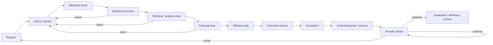
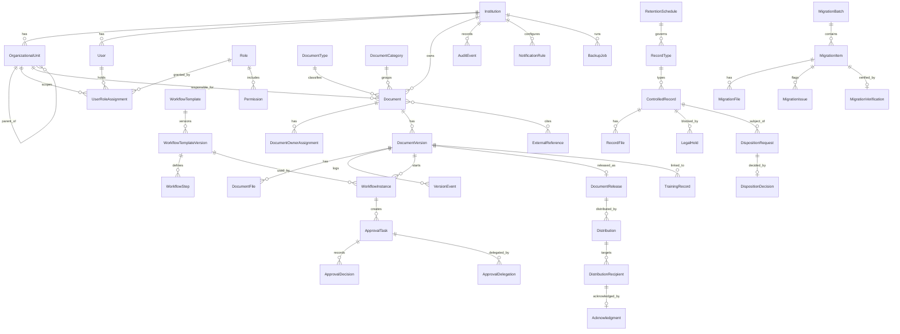
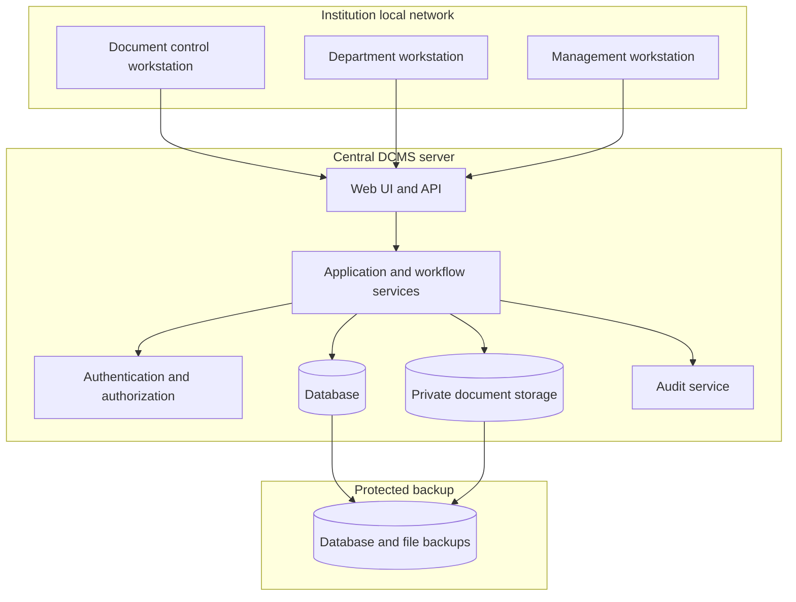

# DCMS Intake Review (Phase 0, tasks 0.1 and 0.2)

**Date:** 2026-11-12
**Status:** DRAFT for the owner's review. Nothing here is approved. Task 0.3 (owner confirmation) is the owner's to tick.
**How it was made:** the first version, written by Freebuff, was deleted by mistake. This version was recreated by Claude by reading every file in this pack, including `reference/` and `specifications/PROPOSAL_BASELINE.md`. It follows `prompts/PROJECT_INTAKE_PROMPT.md` item by item.
**What was NOT done:** no repository exists yet, so no code, schema, or tests were inspected or run. No external law, standard, or regulation was looked up, so **nothing here claims ISO, legal, or privacy compliance**. No code was written and no package was installed.

## Labels used on every statement

| Label | Meaning |
|---|---|
| **[VF]** | Verified fact: stated in a pack file (the file is named) |
| **[AS]** | Assumption: not stated anywhere, needed to continue. Must be confirmed |
| **[RC]** | Recommendation: my suggestion. Not an approved requirement |
| **[OD]** | Open decision awaiting the owner. Tracked in `OPEN_DECISIONS.md` (D-xxx) |

---

## 1. Understanding of the product and its boundaries

**What it is.**
- [VF] DCMS is a configurable, institution-independent platform to control institutional documents and related operational records, initially for healthcare institutions (`PROJECT_VISION.md` s1).
- [VF] It runs as a client-server application on a local network. Core functions must work without internet. The central server is the source of truth (`PROJECT_VISION.md` s3, `SYSTEM_ARCHITECTURE.md` s1).
- [VF] It covers the full document life: request, draft, review, approval, release, distribution, acknowledgment, periodic review, revision, withdrawal, archive (`DOCUMENT_LIFECYCLE.md`).
- [VF] It supports three onboarding cases: new institution, existing institution with documents to migrate, and partially documented institution (`PROJECT_VISION.md` s4).

**What it is not.**
- [VF] Not an EMR, hospital information system, laboratory, pharmacy, or patient charting application. It must not store patient histories, prescriptions, patient lab results, or charts as ordinary records. It may control the policies and procedures that govern those records (`PROJECT_VISION.md` s6, `AI_INSTRUCTIONS.md` s5).
- [VF] Not an automatic approver: upload or migration never equals approval (`BUSINESS_RULES.md` 5, `FR-12.6`).
- [VF] Not a one-institution app: departments, approval chains, document codes, and retention periods must be configurable, never hard-coded (`AI_INSTRUCTIONS.md` s5 and s7).

**Boundaries that drive design.**
- [VF] Approval, authorization, effective date, and release are distinct events (`BUSINESS_RULES.md` 6, 7).
- [VF] Released versions are never silently edited or replaced. Revisions keep links to previous versions (`BUSINESS_RULES.md` 8, 9).
- [VF] Acknowledgment is not proof of training or competency (`BUSINESS_RULES.md` 11).
- [VF] Retention expiry never authorizes destruction on its own (`BUSINESS_RULES.md` 19, 20).
- [VF] System administrator rights do not give approval authority or access to confidential content (`BUSINESS_RULES.md` 17).

**Who the first institution appears to be.**
- [VF] The source guidelines in `reference/` come from Ospital ng Palawan (ONP), a DOH hospital. Its Knowledge Management Team (KMT) runs document control (`ONP_ORIGINAL_GUIDELINES.md` s1, s2).
- [OD] Whether ONP is the first/pilot installation is not yet confirmed by the owner (D-001). I treat ONP as the **reference configuration** only, and nothing ONP-specific goes into application logic.

---

## 2. Module-by-module structure

The pack lists 16 functional modules (`SYSTEM_ARCHITECTURE.md` s3). The original proposal lists 12 (`PROPOSAL_BASELINE.md` s5). The proposal groups several of them together. The pack adds Training Evidence and splits Reports/Notifications from Backup. [VF]

| # | Module | Purpose | ONP reference evidence |
|---|---|---|---|
| 1 | Institution setup | Institution identity, settings, timezone, status | Hospital name, logo, timezone |
| 2 | Organizational structure | Divisions, departments, sections, units, offices (parent-child) | Service, section, unit, committee lists (`ONP_CODE_LISTS.md`) |
| 3 | User and access management | Accounts, roles with scope and validity | KMT, QMR, MCC, Process Owner |
| 4 | Document registry | Identity, code, title, owner, classification, status | Document Control Register (Annex 1) |
| 5 | Document creation and revision | Create, draft, revise, change summary | Templates (Annex 4 to 6), revision history table |
| 6 | Configurable workflow engine | Templates, stages, instances | Approval chain varies by document type |
| 7 | Review and approval | Decisions with evidence | QMR review, MCC approval |
| 8 | Version control and release | Immutable released versions, effective dates | Master Copy |
| 9 | Distribution and acknowledgment | Exact-version distribution, recipient tracking | Authorized Copies, Annex 3 register |
| 10 | Training evidence | Link training records to versions | Not in ONP sources |
| 11 | Existing-document migration | Batch import, verify, reconcile | CSAC front page is a test sample |
| 12 | External references | Standards, laws, guidance linked to documents | DOH, PhilHealth, CSC forms (external forms) |
| 13 | Operational records and retention | Retention schedules, legal hold, disposition | 3-year default, per-document retention |
| 14 | Audit and compliance | Append-only audit events | Annual audit by KMT |
| 15 | Reports and notifications | Reports, reminders, alerts | KPIs (turnaround, audit, accuracy) |
| 16 | Backup and recovery administration | Backup jobs, verification, restore tests | Monthly hard-copy printout of Master List |

[RC] Two modules the pack does not list, driven by the ONP source (see section 8): **Code management** (managed lists of service, section, unit, and type codes plus the code request and validation process) and **Authorized copy control** (issue and retrieval of numbered copies per unit). They could be sub-modules of the registry and distribution modules. Not approved.

---

## 3. End-to-end workflow map

### 3.1 Generic lifecycle (the pack)
[VF] The 15 stages in `DOCUMENT_LIFECYCLE.md`: need identified, request initiated, draft or source file uploaded, registration metadata checked, department review, technical/quality review, final approval, registration finalized, effective date assigned, controlled release, distribution, acknowledgment and/or training, periodic review, revision/withdrawal/continued validity, supersession and archive.

[VF] Statuses are kept separate: document status, version status, workflow status, distribution status. One status column must not carry all of them.

### 3.2 Configurable approval workflows
- [VF] A workflow template defines name, applicable document types, scope, trigger, ordered or parallel stages, eligible role/user/unit, required action, mandatory or optional stages, due dates, quorum, return behavior, delegation, escalation, whether the author may take part, separation-of-duty rules, and template version (`WORKFLOW_ENGINE.md` s2).
- [VF] Each submitted version starts an instance that stores the exact template version used. Editing a template never changes running instances (`WORKFLOW_ENGINE.md` s3, `BUSINESS_RULES.md` 13).
- [VF] Authority is checked again at the moment of action, not only when the task was assigned (`BUSINESS_RULES.md` 14).
- [VF] Decisions are append-only evidence. Corrections are new events (`WORKFLOW_ENGINE.md` s3).
- [VF] Minimum stage patterns: sequential, parallel, parallel then final approval, role-based, named-user, organizational-unit assignment, optional stage, return and resubmit, final approval then a separate release.
- [VF] Quorum, substitute reviewers, and conditional routing may come in later phases if approved. Exact approval and quorum rules are to be finalized with the institution (`WORKFLOW_ENGINE.md` s4, `PROPOSAL_BASELINE.md` s7.1).
- [OD] D-004 is approved in principle: workflows are fully configurable. D-017 (sequence and quorum rules) is open.

### 3.3 Workflow state machine
[VF] Starting point only, to be validated: Draft, Submitted, InReview, ReadyForApproval, Approved, PendingRelease, Released, plus ReturnedForRevision, Cancelled, RevisionInProgress, Withdrawn, Superseded, Archived (`WORKFLOW_ENGINE.md` s7). Decision vocabulary: pending, reviewed, recommended, approved, rejected, returned_for_revision, cancelled, delegated. A single ambiguous "approved" must not serve every stage.

### 3.4 How ONP's current process maps (reference configuration, not product behavior)

| ONP step (`ONP_ORIGINAL_GUIDELINES.md` s5, s6) | Closest DCMS concept | Label |
|---|---|---|
| Process Owner raises a DRRF | Document request + code request | [VF] |
| KMT validates codes (Control Point 1) and checks duplicates (Control Point 2) | Registration metadata check | [VF] |
| KMT assigns code, emails it; high-risk documents also go to MCC/QMR and the Quality Management Committee approves the code | A code approval step. **No equivalent exists in the pack** | [VF] |
| Process Owner drafts on the Annex 4/5/6 template | Draft preparation | [VF] |
| KMT verifies, QMR accountable | Review stage(s) | [VF] |
| MCC signs the Master Copy | Final approval | [VF] |
| KMT stamps (blue), registers, files Master Copy | Registration finalized and, possibly, release | [OD] Which ONP step is "release" and which is "effective date"? |
| KMT issues purple-stamped Authorized Copies, recorded per copy | Distribution to exact version | [VF] |
| 3-year review, or sooner | Periodic review | [VF] |
| Old copies surrendered, old version stamped red | Supersession and retrieval | [VF] |

---

## 4. Role and authority model

### 4.1 Organizational hierarchy is not approval authority
- [VF] Organizational units form a parent-child tree. This tree must not automatically be treated as the approval hierarchy (`FR-02.4`, `BUSINESS_RULES.md` 16).
- [VF] Authority is configured by document type, category, organizational scope, and workflow template. The pack forbids one universal approval matrix (`ROLES_AND_PERMISSIONS.md`).
- [RC] Model the two separately: `OrganizationalUnit` (who sits where) and an **authority assignment** (who may review, recommend, approve, release, withdraw, or authorize disposal, for which document types and scopes, between which dates).

### 4.2 Roles (configurable starting points)
[VF] System Administrator, QMS Administrator, Document Controller, Department Head, Document Coordinator, Technical Reviewer, Approving Authority, General Personnel, Internal Auditor (`ROLES_AND_PERMISSIONS.md`).

### 4.3 Permission dimensions
[VF] subject (user and active role assignment), action (view, create, edit, submit, review, recommend, approve, release, distribute, withdraw, archive, export, configure), resource, scope (institution, branch, department, assigned documents, individual record), classification (public, internal, confidential, restricted or configured levels), and validity dates.

### 4.4 Separation of duties
[VF] Technical administration does not confer approval. Authors may not approve their own document where policy requires independence. A reviewer's recommendation is not final approval unless the configuration says so. Release is distinct from approval. Delegation is time-limited, scoped, authorized, and audited.

### 4.5 ONP evidence (not yet confirmed as the approval model)
| ONP role | What the source says | Closest generic role | Label |
|---|---|---|---|
| Knowledge Management Team (KMT) | Exclusive code authority. Registers, stamps, distributes, audits yearly | Document Controller | [AS] |
| Process Owner (unit/division head) | Writes and revises, reviews every 3 years | Document Coordinator / Department Head | [AS] |
| Quality Management Representative (QMR) | Reviews before approval, accountable for the annual audit | Technical/Quality Reviewer | [AS] |
| Medical Center Chief (MCC) | Final approver of all Master Copies | Approving Authority | [AS] |
| Quality Management Committee | Approves codes for high-risk documents | A committee-based approver (needs a committee/quorum concept) | [AS] |
| Forms Committee | Approves internal forms before coding | Committee approver | [AS] |
| Department Head, Service Chief | Listed as reviewers on policy and guideline templates | Department Head / Reviewer | [AS] |

[OD] The exact approval chain per ONP document type is not defined in the sources (D-003, D-017).

---

## 5. Conceptual ERD

[VF] The pack's domain model is conceptual only. Cardinalities, column types, and constraints must be approved before any migration is generated (`DOMAIN_MODEL.md`). This ERD follows the pack's entity list. Additions driven by the ONP source are in section 5.3 and are **proposals**.

### 5.1 Entities and relationships (pack)

### 5.2 Important constraints
| Constraint | Source | Label |
|---|---|---|
| A Document is a stable identity. It is not a file or a revision | `DOMAIN_MODEL.md` | [VF] |
| A version's identifier is unique within its document | `FR-08.1` | [VF] |
| Each file stores metadata, storage location, media type, size, hash, uploader, timestamp | `DOMAIN_MODEL.md` | [VF] |
| A WorkflowInstance is tied to one version and one template version. Template edits never change it | `DOMAIN_MODEL.md`, `FR-06.9` | [VF] |
| Approval decisions are append-only, not a mutable field on Document | `DOMAIN_MODEL.md` cautions | [VF] |
| Distribution references a release/version, never only the document | `DOMAIN_MODEL.md`, `FR-09.1` | [VF] |
| Released versions are immutable to ordinary users | `FR-08.2` | [VF] |
| Approval date, effective date, release date, and supersession are separate fields/events | `FR-08.3` | [VF] |
| Legal hold blocks routine disposition | `FR-11.4` | [VF] |
| Migration items keep original metadata separate from normalized fields | `DOMAIN_MODEL.md` | [VF] |
| Audit records are not editable by ordinary users | `FR-13.4` | [VF] |
| No comma-separated version history. No arbitrary JSON for permissions that need relational enforcement | `DOMAIN_MODEL.md` | [VF] |
| Referenced history is deactivated or archived, never deleted | `DOMAIN_MODEL.md` | [VF] |
| Exactly one currently effective version per document at a time, enforced by the database | `PROPOSAL_BASELINE.md` s8 rule 7 says users must see the effective version | [RC] |
| Code uniqueness scope per institution, with configurable duplicate rules that never alter imported codes | `FR-04.5` | [VF] for the rule, [OD] for the scope (D-021) |

### 5.3 Proposed additions from the ONP source (NOT approved)
| Proposed entity | Why | Label |
|---|---|---|
| CodeList and CodeValue (service, section, unit, committee, document type) | ONP validates every code against official lists (Control Point 1). The pack only says numbering formats and sequences are configurable (`FR-04.3`) | [RC] |
| DocumentCodeRequest (the DRRF) | ONP's request form with returned/accepted dates and the 24-hour return rule | [RC] |
| CodeSequence | Next free sequence per configured scope, safe against two people asking at once | [RC] |
| AuthorizedCopy | ONP tracks each numbered copy: unit, holder, issue date, retrieval date | [RC] |
| DocumentRevisionHistoryEntry | ONP prints a revision history table in each document: version, review date, change description, effectivity date | [RC] |
| High-risk flag and code-approval step | ONP routes high-risk documents to MCC/QMR and a committee for code approval | [RC] |
| External-form / exemption flag | ONP exempts some documents from standard coding and keeps external codes | [RC] |
| WorkingCalendar | ONP's KPI is 7 *working* days | [RC] |

---

## 6. Application architecture and deployment topology (offline LAN)

### 6.1 Topology
[VF] Browser clients on the institution network connect to one central DCMS server. The server holds the web/API, application and workflow services, authentication and authorization, database, private document storage, and the audit service. A separate protected backup target holds database and file backups (`SYSTEM_ARCHITECTURE.md` s1, s7).

### 6.2 Layers and request flow
[VF] Layers: presentation, application, domain, infrastructure, security. Request flow: Browser, web/API, authentication and authorization, use case, domain validation, database transaction plus file service, audit event, response or notification (`SYSTEM_ARCHITECTURE.md` s2, s5).

### 6.3 Core rules
[VF] Central server is the source of truth. Released files are not edited in shared folders. Business rules are enforced on the server. Storage is not public, executable, or browsable. Workflow transitions are explicit and validated. Browser state is never proof of approval or authorization.

### 6.4 Technology
- [VF] Candidate only: Laravel/PHP, React (the proposal adds TypeScript), Tailwind, Vite, MySQL or MariaDB, private server filesystem, authenticated API. This is not approved (`TECHNICAL_DECISIONS.md`, `PROPOSAL_BASELINE.md` s14).
- [OD] D-006 (stack), D-007 (server OS and hardware), D-008 (authentication and account recovery on an offline LAN), D-010 (file types, sizes, preview), D-013 (backup schedule, destination, RPO/RTO).
- [VF] Not decided in a prior chat but agreed by the owner: automation (reminders, scheduled checks, notifications) is coded inside the app, not in an external automation tool.

### 6.5 Operational planning items
[VF] Local DNS or a fixed server address, HTTPS inside the institution where feasible, firewall rules, server account permissions, time synchronization, backup storage, UPS/power interruption handling, documented recovery (`SYSTEM_ARCHITECTURE.md` s6).

[RC] Because the ONP process currently uses email for DRRFs and code notices, decide early how notices work on a closed LAN (in-app notifications first, an internal mail server later if wanted). `FR-14.3` already requires local notifications without internet.

---

## 7. Risks

| # | Area | Risk | Suggested control [RC] |
|---|---|---|---|
| 1 | Security | Direct file download by guessing a URL or id (insecure direct object reference) | Authorize every download on the server, generated storage names, no public path |
| 2 | Security | Admin account used to approve or read confidential documents | Authority separate from technical role (`BUSINESS_RULES.md` 17). Test it |
| 3 | Security | Self-approval or conflicting duties in a workflow | Enforce at decision time, test with role changes mid-task |
| 4 | Security | Weak login or account recovery on an offline LAN | Decide D-008 before building authentication |
| 5 | Security | Malicious upload or filename | Validate type and size, store outside executable paths, store hashes |
| 6 | Privacy | Patient-identifiable data ending up in documents, evidence records, or attachments | Keep the scope rule visible, warn at upload, classification levels. Legal analysis of RA 10173 is **unverified** and is for the institution's DPO and legal adviser |
| 7 | Privacy | Personal data of staff in acknowledgment, training, and audit records | Data minimization, access scopes, retention rules (D-011) |
| 8 | Integrity | A released version silently replaced | Domain rule, database permission, hash checks, tests |
| 9 | Integrity | Database changed but file save fails, or the reverse | One coordinated transaction plus file service, reconciliation job |
| 10 | Integrity | Two people receive the same code number at the same time | Sequence assignment inside a locked transaction, with a database uniqueness constraint |
| 11 | Integrity | Wrong "current" version because the server clock is off, or effective dates mishandled | Time synchronization, timezone setting, separate approval/effective/release fields |
| 12 | Integrity | Editing a workflow template changes documents already in review | Version templates, instances keep their version |
| 13 | Migration | An imported file treated as approved, or invented approval dates | Import never approves, source values stored separately, verification queue |
| 14 | Migration | Overwriting a current document because a code matches | Duplicate/conflict flagging, human resolution |
| 15 | Migration | "Fixing" typos or code mistakes in source documents silently | Preserve source text. Corrections are explicit decisions (D-023) |
| 16 | Migration | ONP code lists have duplicates and overlong codes, so seeding them blindly causes bad validation | Decide D-019 to D-021 first, then load as editable data |
| 17 | Operational | One server fails, power cut, or disk full | UPS, monitored backups, a documented recovery plan |
| 18 | Operational | Backup exists but cannot be restored | Restore test is a gate. A backup is not "verified" until restored (`BUSINESS_RULES.md` 24) |
| 19 | Operational | Paper and digital running together create two sources of truth | Decide D-022: what stays on paper, cut-over rules, "uncontrolled copy" markings |
| 20 | Operational | Reports say success without evidence | Never report backup or test success without recorded evidence |
| 21 | Development | An AI agent edits unrelated files, loops, or ticks owner gates | `knowledge.md` rules: allowlist, two-failures-then-stop, gates are ticked by the owner only. Use Git |
| 22 | Compliance | Claiming compliance with ISO, DOH, or privacy law from the software alone | Compliance is not claimed. Requirements mapping must come from verified current sources (D-014) |

---

## 8. Contradictions, gaps, and open decisions

### 8.1 Contradictions and inconsistencies between sources
1. **Roadmap.** The pack has Phases 0 to 8, the proposal has Phases 0 to 10. The pack starts audit events in Phase 3, the proposal puts the audit trail in Phase 9. [RC] Audit logging should start early, because every later feature depends on it. **[OD] D-018.**
2. **Module lists.** Pack: 16 modules. Proposal: 12. The pack adds training evidence and splits others. Not a conflict, but the two lists must be reconciled for the plan.
3. **Stack.** The pack: Laravel/React/Tailwind/MySQL-MariaDB. The proposal adds TypeScript, Vite, REST/JSON. `TECHNICAL_DECISIONS.md` also asks whether the frontend is React or Laravel-rendered. **[OD] D-006.**
4. **ONP code format vs its own examples** (missing sections, `[SER]` vs `[DIV]`, document type length, `POL` vs `POLC`). **[OD] D-019.**
5. **ONP revision numbering** (Rev 1.0 vs Rev 0, Rev 1). **[OD] D-020.**
6. **ONP duplicate and overlong codes** (`ERD`, `OPD`, `NIC`, `PIC`, `CPC`, `MHT`, about 14 over 3 letters, `FORM` used for both a committee and a document type). **[OD] D-021.**
7. **ONP annex numbering, form codes, title size (12 vs 14 pt), and GUID-002's header title.** **[OD] D-023.**
8. **ONP document type letters** in the registers (IF, EF, M, P, G, R) vs the coding list (POLC, PROC, FORM, MANL, RECD, GUID, WI, ROR). **[OD] D-019.**
9. **ONP retention** (3 years or until rescinded vs 3 and 5 years in samples vs a per-document column). **[OD] D-011.**
10. **Master Code Register vs Document Control Register** in ONP: unclear if one or two registers. **[OD] D-019.**
11. **"Always configurable" vs ONP's fixed prefix `ONP-` and fixed list structure.** Resolved by treating them as configuration. [RC] Confirmed only when D-019 is decided.
12. **Notifications on an offline LAN vs ONP's email-based DRRF.** `FR-14.3` requires local notifications. [OD] Is email used on the real LAN?

### 8.2 Missing requirements (not covered by the pack or the proposal)
| # | Gap | Label |
|---|---|---|
| 1 | A **code approval** step for high-risk documents (committee approves the code, not only the document) | [OD] |
| 2 | **Managed code vocabularies** and the two validation checkpoints (valid codes, then no duplicates), with a 24-hour return rule | [OD] |
| 3 | **Authorized copy control**: numbered copies per unit, issue, retrieval, and surrender of old copies on revision | [OD] D-022 |
| 4 | **Physical-copy conventions** (blue, purple, red stamps, shredding rules, monthly hard-copy Master List) and what replaces them | [OD] D-022 |
| 5 | **Emergency and ICU protocols** used before registration, with a rule for registering them afterward | [OD] D-022 |
| 6 | **Document templates** (Annex 4 to 6) and format compliance (KPI: 100%) | [OD] |
| 7 | **KPI reporting** (turnaround within 7 working days, audit compliance, document accuracy) and a **working-day calendar** | [OD] D-016 |
| 8 | **Annual audit** support (match register against the inventory) | [OD] |
| 9 | **Exemption and external-form handling** (registered, keep external code) | [OD] |
| 10 | **Which ONP step equals release and effective date** | [OD] |
| 11 | **Electronic signature** standard, if any | [OD] D-009 |
| 12 | **Confidentiality labelling**: ONP forms carry "CONFIDENTIAL RA 10173 PROTECTED". Required text and rules are unverified | [OD] D-014 |
| 13 | **Source-document corrections** workflow (who decides, how recorded) | [OD] D-023 |

### 8.3 Open decisions
The register is `governance/OPEN_DECISIONS.md` (D-001 to D-023). Grouped by what they block:

| Blocks | Decisions |
|---|---|
| Starting any coding (Phase 1 approval) | D-001, D-005, D-006, D-007, D-008, D-018 |
| Domain model and workflows (Phase 1.2 to 1.4) | D-003, D-004 (approved in principle), D-009, D-017, D-019 to D-022 |
| Security and operations design | D-008, D-009, D-012, D-013 |
| Seeding ONP data (Phase 2) | D-019, D-020, D-021, D-023 |
| Migration (Phase 6) | D-010, D-015, D-023 |
| Retention and reports (Phase 7) | D-011, D-016 |
| Compliance mapping (before any claim) | D-014 |

### 8.4 The questions that matter most (maximum five)
These are unanswered and block the Phase 1 gate. Questions already answered in the conversation (NRS means Nursing, n8n is not used) are not repeated.
1. **First institution and tenancy.** Is Ospital ng Palawan the first (pilot) installation, and is DCMS one institution per installation? (D-001, D-005)
2. **Roadmap.** Follow the pack's Phases 0 to 8 or the proposal's 0 to 10? (D-018)
3. **Technology and server.** Approve Laravel and React with MySQL or MariaDB, or choose another stack, and what server hardware and operating system will be used? (D-006, D-007)
4. **Approval versus release at ONP.** Is the MCC's signature "approval", and is KMT's stamping and registration "release", with the effective date set at which step? Who else must approve beyond the MCC? (D-003, D-017)
5. **Paper.** Will ONP stop using ink stamps and paper Authorized Copies, or keep them alongside DCMS during the transition? (D-022)

---

## 9. Phased development plan, acceptance criteria, and test strategy

[VF] Phase scope follows `governance/DEVELOPMENT_PROCESS.md`. Phase numbering may change under D-018. A phase does not start until the previous one is reviewed and its acceptance criteria are met.

| Phase | Scope | Acceptance criteria [RC] | Main tests |
|---|---|---|---|
| 0 Intake | Read the pack, summarize, list gaps | This review exists and the owner confirms it (task 0.3, owner ticks) | None (documentation) |
| 1 Architecture approval | Decisions recorded, domain model/ERD, API boundaries, security model, workflow behavior, authority matrix | Every blocking decision in section 8.3 recorded with approver and date. ERD and authority matrix approved. "Phase 1 approved" ticked by the owner | Review checklist against `FR-*` ids |
| 2 Foundation | Repo and environment, authentication and users, institution and organization setup, roles and permissions, seed data, automated tests | A user logs in locally. Roles and scopes enforced on the **API**. Direct unauthorized API calls fail. Admin cannot approve. ONP lists load as editable data | Authorization tests for every role and scope. Tests on the server, not only the UI |
| 3 Document control core | Types, categories, registry and numbering, versions and files, lifecycle, audit events | Documents register with a configured code. A released version cannot be overwritten. Hashes are stored and verified. Every important change writes an audit event. Duplicate codes are caught safely under simultaneous requests | Version integrity, hash round trip, concurrent code assignment, audit append-only |
| 4 Workflow engine | Template versions, sequential and parallel stages, tasks and decisions, return, delegation, separation of duties, final approval then separate release | A document follows a configured chain. Template edits do not change running instances. Self-approval is blocked. Authority is re-checked at action time | All workflow engine tests listed in `TESTING_AND_VERIFICATION.md` |
| 5 Distribution | Targets, exact-version distribution, acknowledgment, training evidence, authorized-copy control if approved | Distribution always names the exact version. Pending, acknowledged, exempted, overdue are tracked. Acknowledgment is not shown as training | Distribution and acknowledgment tests, revision-triggers-new-acknowledgment test |
| 6 Migration | Batch upload, mapping, duplicate/conflict detection, verification queue, reconciliation | Imported items are never approved automatically. Source values and hashes are preserved. The reconciliation report matches counts and hashes | Migration tests including duplicate codes, identical hashes, missing approval evidence, conflicting dates |
| 7 Extended controls | External references, records and retention, reports, notifications, backup monitoring | Legal hold blocks disposition. Reports match data. Local notifications work without internet. Backup status shows evidence | Retention trigger, hold, disposition approval, backup integrity tests |
| 8 Verification and deployment | Full testing, user acceptance, migration rehearsal, deployment and admin documents, training, controlled go-live | No critical tests failing, no security check unverified, backup **restored** to a test environment and checked, owner signs acceptance | Whole suite, restore test, UAT with realistic institutional scenarios |

**Test strategy.**
- [VF] A feature is not complete because code was written or a page renders. It needs tests and observed evidence. Each test records id, requirement id, preconditions, steps, expected and actual result, pass/fail/blocked, environment, date and tester, and evidence reference. Tests not run must be named (`TESTING_AND_VERIFICATION.md`).
- [RC] Use real ONP examples as test data for the code validator (a valid code, an invalid service, a missing section, a duplicate, `NRS` before and after it is added to the lists).
- [RC] Run authorization tests against the API directly with each role, because hiding a button is not security.
- [RC] Keep the CSAC front page and the ONP guideline documents as the first migration samples.

---

## 10. What is verified, assumed, recommended, and awaiting approval

**Verified (stated in the pack).** The product scope and exclusions in section 1. The module list, lifecycle, workflow engine rules, role model and separation of duties, domain model entities, deployment topology, architecture rules, testing standard, and phase list. The ONP guideline content in `reference/`, as source material.

**Assumptions to confirm.** The ONP-to-generic role mapping in 4.5. That KMT acts as the Document Controller. That ONP is the first institution. That the ONP lists in `ONP_CODE_LISTS.md` are complete (the example `NRS` and `CLN` are not in them).

**Recommendations (mine, not approved).** Code management and authorized-copy control as modules or sub-modules. The ERD additions in 5.3. Early audit logging. A one-current-version database rule. In-app notifications before any mail server. Using ONP examples as test data.

**Decisions awaiting the owner.** All Open items in `OPEN_DECISIONS.md` (D-001 to D-023, except D-004 which is approved in principle), with the five most important questions in 8.4.

---

*Stop here. Wait for the owner's review before any decision is recorded or any work moves to Phase 1.*
