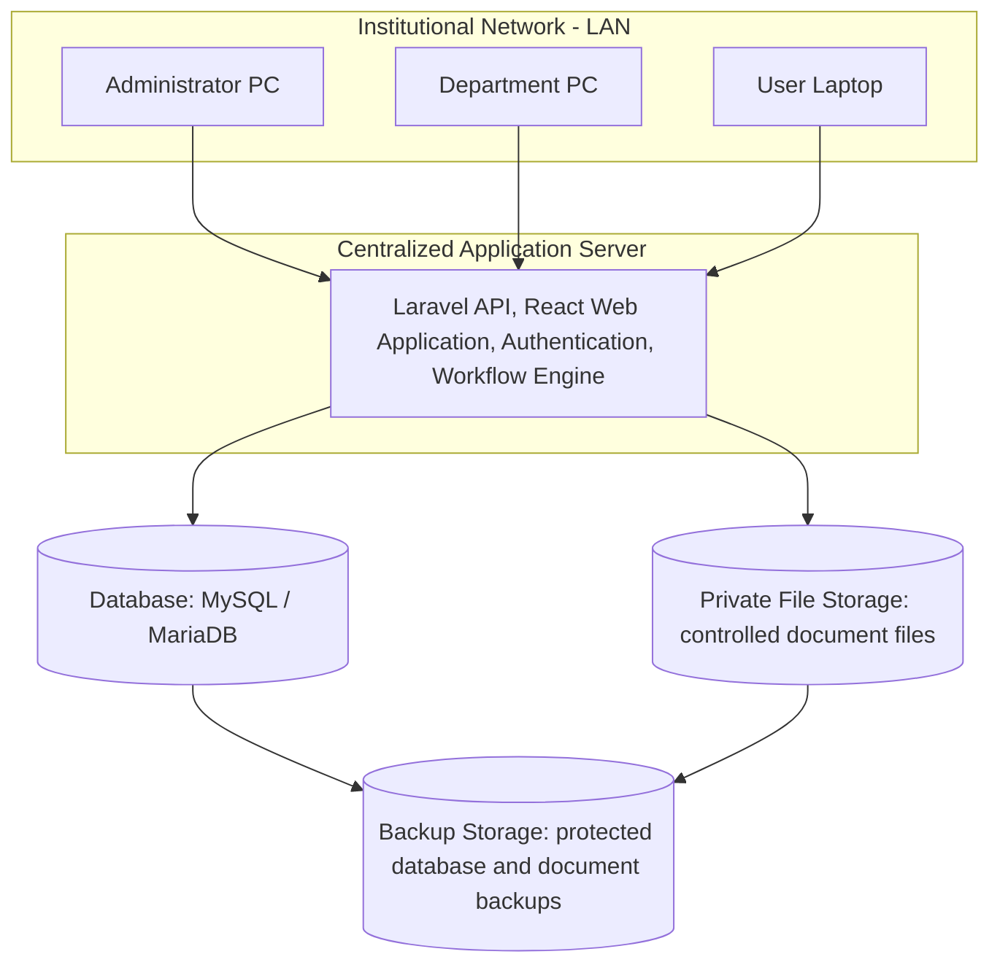

# DCMS Proposal Baseline: Project Overview and Proposed System Specifications

**Source:** "Document Control Management System (DCMS): Project Overview and Proposed System Specifications" (Healthcare Institution), provided by the project owner.
**Project status in source:** Planning and Requirements Finalization.
**Status in this pack:** Requirements baseline. Same authority level as the other approved-for-review specifications. Not an approval to code.

> The text below the line is the project owner's document converted to Markdown. Wording is preserved. The only edits are formatting, and the deployment diagram in section 14.1 (garbled in the source) was redrawn from its labels.

## How this relates to the rest of the pack

Most of this proposal is already reflected in the other pack files. The items below are NOT identical or are NOT yet covered. They are flagged, not resolved. Do not silently pick one side. They are tracked in `governance/OPEN_DECISIONS.md` (D-006, D-014, D-015 to D-018).

### 1. Roadmap differs (tracked as D-018)

| Proposal phase (section 17) | Closest pack phase (`governance/DEVELOPMENT_PROCESS.md`) |
|---|---|
| 0: Requirements gathering, institutional assessment | 0: Intake, and 1: Architecture approval |
| 1: Project foundation and application setup | 2: Foundation |
| 2: Institution and organizational configuration | 2: Foundation |
| 3: User management and access control | 2: Foundation |
| 4: Document registry and file management | 3: Document control core |
| 5: Review and approval workflow engine | 4: Workflow engine |
| 6: Document release, distribution, acknowledgment | 4 (separate release) and 5: Distribution |
| 7: Existing document migration | 6: Migration |
| 8: External references, records, retention | 7: Extended controls |
| 9: Audit trail, reporting, notifications, backup administration | 3 (audit events), and 7 (reports, notifications, backup monitoring) |
| 10: Pilot testing, validation, training, deployment | 8: Verification and deployment |

Notable differences: the pack starts audit events in its Phase 3, the proposal places the audit trail in its Phase 9. The pack has a separate architecture-approval phase before any coding.

### 2. Technology details (tracked under D-006)
The proposal lists React **with TypeScript**, **Vite** as build tool, and **REST API / JSON**. `architecture/TECHNICAL_DECISIONS.md` lists Laravel, React, Tailwind, MySQL/MariaDB but not TypeScript or Vite. Both documents call the stack proposed, and the proposal says exact versions will be selected and compatibility-tested first. Nothing is approved.

### 3. Regulatory and standards references (tracked under D-014)
The proposal names ISO 9001, ISO 10013, Philippine National Standards (PNS), DOH issuances, and the **Data Privacy Act of 2012 (RA 10173)** with applicable National Privacy Commission issuances. The pack names ISO/DOH/Philippine law only generally and does not mention the Data Privacy Act. All of these must be verified against current authoritative sources before any compliance statement is made. The institution's Data Protection Officer and legal adviser evaluate privacy requirements.

### 4. Related quality records
The proposal lists: personnel training and acknowledgment, equipment calibration and maintenance, inspection records, internal audit findings, **corrective and preventive action evidence**, and **quality monitoring and evaluation records**. The pack's vision file covers training, audits, inspections, calibration, and maintenance. Corrective/preventive action evidence and quality monitoring records are only in the proposal. They are in scope only "where approved by the institution".

### 5. Named reports
The proposal names ten reports (section 13). The pack's FR-13.3 only says authorized users can filter and export reports. The named list is a candidate, not an approved requirement (D-016).

### 6. Client confirmation questions (section 20) mapped to the decision register

| Q | Question (short) | Register |
|---|---|---|
| 1 | Type of healthcare institution | D-001 |
| 2 | Departments, divisions, sections | D-002 |
| 3 | Final approval authority | D-003 |
| 4 | Existing ISO/QMS documents? | D-015 (new) |
| 5 | Approximate number of documents | D-015 (new), D-002 |
| 6 | Number of users | D-002 |
| 7 | Server hardware and OS | D-007 |
| 8 | Document formats and file sizes | D-010 |
| 9 | Electronic signatures required? | D-009 |
| 10 | Retention schedules | D-011 |
| 11 | Sequential, parallel, or both; quorum | D-017 (new), D-004 |
| 12 | One institution per installation or multi | D-005 |
| 13 | Backup frequency and recovery targets | D-013 |
| 14 | Reports and export formats | D-016 (new) |
| 15 | ISO edition and regulatory requirements | D-014 |

---

# DOCUMENT CONTROL MANAGEMENT SYSTEM (DCMS)

**Project Overview and Proposed System Specifications**
Proposed System: Healthcare Institution

## 1. Project Overview

The proposed Document Control Management System (DCMS) is a centralized, configurable web-based application designed to help healthcare institutions manage, control, organize, monitor, and maintain their official documents and quality management system (QMS) records.

The system will provide a structured way to manage documents throughout their lifecycle, from creation and review to approval, release, distribution, revision, and retirement.

It aims to reduce manual paperwork, prevent the use of outdated documents, improve document traceability, and provide authorized personnel with easy access to the latest approved versions.

The system will be designed for institutions that are:
- Establishing their documentation and quality management system for the first time.
- Already maintaining an established ISO/QMS documentation system.
- Partially implementing a documentation or quality management system and planning to improve it.

**Important:** The system will adapt to the institution's existing structure and documentation practices. Institutions will not be required to replace valid existing documents or adopt an entirely new numbering system just to use the application.

## 2. Project Objectives

The main objectives are to:
1. Centralize institutional documents in one controlled repository.
2. Standardize document preparation, review, approval, and release.
3. Maintain document version history and revision records.
4. Prevent unauthorized modification or distribution of controlled documents.
5. Support existing document migration without unnecessary rewriting.
6. Monitor document status, review schedules, and expiration dates.
7. Record approvals, acknowledgments, and relevant user activities.
8. Provide reports for management reviews, internal audits, and quality monitoring.
9. Allow different institutions to configure the system according to their own organizational structure and requirements.
10. Support document control processes even without an internet connection, provided the local server and institutional network remain operational.

## 3. System Scope

The system will initially focus on institutional documentation and document-related quality management processes.

### 3.1 Documents covered

The system may manage the following categories:

| Category | Examples |
|---|---|
| Quality Management Documents | Quality Manual, Quality Policy, Quality Objectives |
| Policies | Administrative policies, clinical policies |
| Procedures | Standard Operating Procedures (SOPs) |
| Work Instructions | Step-by-step operational instructions |
| Forms and Templates | Request forms, checklists, controlled templates |
| Clinical Protocols | Approved clinical procedures and protocols |
| Administrative Documents | Office procedures and institutional guidelines |
| Plans | Quality plans, audit plans, improvement plans |
| Controlled Registers | Master lists, controlled document registers |
| External References | ISO standards, DOH issuances, laws, regulations, guidelines |

### 3.2 Related quality records

Where approved by the institution, the system may also maintain or track records associated with quality management, such as:
- Personnel training and document acknowledgment.
- Equipment calibration and maintenance records.
- Inspection records.
- Internal audit findings.
- Corrective and preventive action evidence.
- Quality monitoring and evaluation records.

### 3.3 Exclusions from the initial scope

The initial system is not an Electronic Medical Record (EMR) or Hospital Information System (HIS).

It will not initially manage:
- Patient medical charts.
- Patient diagnoses and medical histories.
- Prescriptions.
- Laboratory results.
- Patient treatment records.
- Other patient-identifiable clinical records.

The system may control the policies and procedures governing how these records should be handled, but it will not replace the applications used to store and process patient information.

Any future expansion involving patient-identifiable information will require separate approval, privacy assessment, security review, and legal evaluation.

## 4. Configurable System Design

One of the primary features of the proposed DCMS is its configurability.

The application will not be restricted to one fixed institutional structure or one predetermined document approval process.

Each institution will be able to configure its own settings.

### 4.1 Institutional configuration

The system will support configuration of:
- Institution name and information.
- Organizational hierarchy.
- Departments, divisions, sections, and units.
- Document classifications and categories.
- Document numbering conventions.
- Document codes and prefixes.
- User roles and permissions.
- Document ownership and responsibilities.
- Review and approval authorities.
- Document review periods.
- Retention rules.
- Document distribution rules.
- Approval workflows.

### 4.2 Three institution onboarding scenarios

**Scenario 1: New institution (starting from scratch).** The institution configures its organizational structure, document classifications, numbering conventions, roles, and approval workflows before creating its initial documents.

**Scenario 2: Existing institution (existing ISO/QMS documents).** The institution imports its existing documents, preserves their original information, verifies their validity, and registers them in the system.

**Scenario 3: Partially documented institution (existing and new documentation).** The institution imports available documents and creates additional documentation for areas that are not yet covered.

**Key principle:** Existing valid documents will be preserved. The system will not automatically rewrite documents, change their codes, or assign new revision numbers during migration.

## 5. Main System Modules

The proposed application will consist of the following major modules.

| No. | Module | Purpose |
|---|---|---|
| 1 | Institution Setup | Configure institutional information and system settings. |
| 2 | Organizational Structure | Manage departments, divisions, sections, and units. |
| 3 | User and Access Management | Manage users, roles, permissions, and access restrictions. |
| 4 | Document Registry and Classification | Register, categorize, and search controlled documents. |
| 5 | Document Creation and Revision | Prepare new documents and manage revisions. |
| 6 | Review and Approval Workflow | Route documents through designated reviewers and approving authorities. |
| 7 | Version Control and File Management | Preserve document versions and protect released files. |
| 8 | Controlled Distribution and Acknowledgment | Distribute approved documents and track acknowledgments. |
| 9 | Existing Document Migration | Import and validate documents from existing systems. |
| 10 | External References | Maintain applicable external standards, laws, and guidelines. |
| 11 | Records and Retention Management | Monitor records, retention schedules, and authorized disposition. |
| 12 | Audit, Compliance, Reports, Notifications, and Backup Administration | Provide traceability, reports, alerts, and operational administration. |

## 6. User Roles and Responsibilities

The system will support configurable user roles. The following are proposed default roles.

| Role | Main Responsibilities |
|---|---|
| System Administrator | Manages technical configuration, system availability, and user accounts. |
| QMS Administrator | Manages QMS configuration, document policies, and quality processes. |
| Document Controller | Registers, checks, tracks, and distributes controlled documents. |
| Department Head | Reviews documents and manages department-level responsibilities. |
| Document Coordinator / Owner | Prepares and maintains assigned documents. |
| Technical / Clinical Reviewer | Reviews technical or clinical content. |
| Approving Authority | Provides formal authorization for document approval. |
| General Personnel | Views applicable released documents and acknowledges them when required. |
| Internal Auditor | Accesses authorized records and audit evidence. |

Roles and permissions will be configurable.

A user may hold more than one role, depending on institutional policy.

**Important separation of responsibilities:** Having system administrator access does not automatically make a person an authorized document approver. Technical permissions and institutional approval authority will be managed separately.

## 7. Document Lifecycle and Approval Workflow

The system will implement configurable document workflows.

The following represents the proposed standard document lifecycle.

1. **Document Request or Requirement:** A new document or revision is requested.
2. **Draft Preparation:** The document owner prepares the content.
3. **Document Controller Review:** Checks document registration, classification, and required metadata.
4. **Department and Technical Review:** Relevant department, technical, clinical, or quality reviewers assess the content.
5. **Final Approval:** The designated approving authority provides formal authorization.
6. **Approved Version Registration:** The approved version and its approval evidence are recorded.
7. **Effective Date and Controlled Release:** The document becomes officially effective and available to authorized users.
8. **Distribution and Acknowledgment:** Relevant personnel receive access and acknowledge the required version.
9. **Periodic Review:** The document is reviewed for continued validity and relevance. Outcomes:
   - **Continue:** Retain current version.
   - **Revise:** Start a new revision.
   - **Withdraw:** Retire under authorization.

### 7.1 Workflow flexibility

Not every document requires the same approval process.

For example:
- An administrative form may require department review and department-head approval.
- A clinical protocol may require clinical review, quality review, and approval by a designated clinical authority.
- A quality manual may require multiple management-level approvals.

The institution will be able to configure workflows based on document type, department, risk, and approval authority.

The system is intended to support sequential and parallel review stages, optional and mandatory reviewers, return for revision, rejection, due dates, and authorized delegation.

Exact approval and quorum rules will be finalized with the institution.

## 8. Document Version Control

The system will maintain a controlled history of document versions.

Each registered document may contain:
- Document code.
- Document title.
- Document category.
- Department or owner.
- Revision number.
- Version history.
- Approval authority.
- Approval date.
- Effective date.
- Review date.
- Current document status.
- Associated file.
- Previous versions.
- Revision description and reason.

### Version control rules
1. Approved and released documents cannot be silently overwritten.
2. Revisions create new versions.
3. Previous approved versions remain preserved.
4. A new revision must undergo its required review and approval process.
5. Superseded documents must be clearly identified.
6. Only authorized users may withdraw or replace released documents.
7. Users should be able to identify the currently effective version.

## 9. Existing Document Migration

The system will provide an import process for institutions with existing documentation.

Supported formats will be finalized during requirements assessment, with PDF, DOCX, and XLSX among the proposed formats.

The migration process will aim to preserve:
- Original document code.
- Original document title.
- Existing revision number.
- Approval information.
- Effective date.
- Department and document owner.
- Existing document file.
- Historical versions, where available.

### Migration verification

Imported documents will not automatically become approved merely because they were uploaded.

Each document will undergo a verification process.

Possible migration statuses include:
- Pending Verification
- Verified
- Requires Correction
- Duplicate
- Conflicting Information
- Obsolete
- Superseded
- Rejected for Migration

The system will also provide migration reports showing successful imports, failed imports, warnings, and unresolved items.

## 10. Controlled Distribution and Personnel Acknowledgment

The system will allow authorized personnel to access documents according to their assigned permissions and organizational responsibilities.

Features may include:
- Department-specific document distribution.
- User-specific document access.
- Controlled document viewing and downloading.
- Acknowledgment tracking.
- Notification of new or revised documents.
- Tracking of personnel who have not acknowledged required documents.
- Identification of the exact version acknowledged.

Acknowledgment records will be associated with a specific released document version.

**Important:** Acknowledgment does not automatically prove that personnel received training, understood the document, or demonstrated competency. These are separate activities that may be recorded through additional institutional processes.

## 11. Periodic Review and Document Monitoring

The system will support periodic document reviews.

Authorized users will be able to monitor:
- Documents due for review.
- Overdue reviews.
- Documents awaiting revision.
- Documents awaiting approval.
- Documents pending release.
- Documents scheduled for withdrawal.
- Documents with unresolved migration issues.

Review outcomes may include:
- No revision required.
- Revision required.
- Document withdrawn.
- Further technical evaluation required.

Each review will retain the reviewer, review date, decision, reason, and next review date where applicable.

## 12. Records and Retention Management

The system may support institutional records management based on approved retention schedules.

This may include:
- Record classification.
- Record owner.
- Creation date.
- Retention period.
- Retention start date.
- Scheduled disposition date.
- Legal hold status.
- Authorized disposition approval.
- Disposition history.

Records will not automatically be deleted simply because their retention period has expired. Any destruction or disposal must follow the institution's approved policies and applicable legal requirements.

## 13. Audit Trail and Reports

The system will maintain an audit trail of important activities.

Examples include:
- Document creation.
- Document modification.
- Document submission.
- Review and approval.
- Rejection and return for revision.
- Document release and withdrawal.
- User and permission changes.
- Document migration.
- Distribution and acknowledgment.
- Retention and disposition activities.
- System configuration changes.

Reports may include:
- Master Document List.
- Document Status Report.
- Document Revision History.
- Pending Approval Report.
- Overdue Review Report.
- Department Document Inventory.
- Personnel Acknowledgment Report.
- Migration Summary.
- Audit Trail Report.
- Retention and Disposition Report.

Final reports and export formats will be confirmed with the institution.

## 14. Proposed Technology and Deployment

The proposed technology stack is:

| Component | Proposed Technology |
|---|---|
| Backend | Laravel / PHP |
| Frontend | React with TypeScript |
| UI Framework | Tailwind CSS |
| Build Tool | Vite |
| Database | MySQL or MariaDB |
| Communication | REST API / JSON |
| File Storage | Private server-side storage |
| Version Control | Git |
| User Access | Web browser over institutional LAN |

Exact software versions will be selected and compatibility-tested before project implementation.

### 14.1 Deployment architecture

The proposed deployment uses a centralized local server.

### 14.2 Offline operation

The application is intended to operate within the institution's local network without requiring continuous internet access.

This means:
- Users can access the system through their browsers using the local network.
- Document management and approval workflows can operate locally.
- Database and document storage remain on the institution's server.
- Internet access is not required for normal internal operations.

However, offline operation does not mean the system works without its local server, electricity, or network connectivity. Backup and recovery procedures will be required to address outages.

## 15. Security and Data Protection

The system will incorporate security measures appropriate for institutional document management.

Proposed security features include:
- Role-based access control.
- Department-level access restrictions.
- Server-side authorization.
- Secure authentication and password handling.
- Private document file storage.
- Protected file downloads.
- Upload validation and file type restrictions.
- Audit logging.
- Protection against unauthorized document replacement.
- Database and document backups.
- Restricted database access.
- Secure network configuration.
- HTTPS within the institutional network where feasible.

The system will be designed with consideration for the Philippine Data Privacy Act of 2012 (Republic Act No. 10173), applicable National Privacy Commission issuances, and institutional privacy policies.

The institution's Data Protection Officer and legal adviser should evaluate the applicable requirements.

## 16. ISO and Quality Management Considerations

The system is intended to support document control and documented-information management associated with a Quality Management System.

It will be designed with consideration for applicable requirements and guidance, including:
- ISO 9001 documented-information requirements.
- ISO 10013 guidance on documented information, where applicable.
- Applicable Philippine National Standards (PNS).
- Relevant Department of Health (DOH) issuances.
- Other applicable healthcare regulations and institutional policies.

The applicable ISO edition and healthcare-specific requirements must be verified during project planning.

**Important:** Having this software does not automatically establish ISO compliance, guarantee certification, or guarantee compliance with all healthcare regulations. Compliance depends on the institution's actual processes, implementation, evidence, and evaluation.

## 17. Proposed Implementation Roadmap

Development will be divided into phases to reduce risks and allow proper testing.

| Phase | Description |
|---|---|
| Phase 0 | Requirements gathering, institutional assessment, and confirmation of business rules. |
| Phase 1 | Project foundation and application setup. |
| Phase 2 | Institution and organizational configuration. |
| Phase 3 | User management and access control. |
| Phase 4 | Document registry and file management. |
| Phase 5 | Review and approval workflow engine. |
| Phase 6 | Document release, distribution, and acknowledgment. |
| Phase 7 | Existing document migration. |
| Phase 8 | External references, records, and retention. |
| Phase 9 | Audit trail, reporting, notifications, and backup administration. |
| Phase 10 | Pilot testing, institutional validation, user training, and deployment. |

Each phase will have its own deliverables and testing requirements.

Development will not proceed to the next major phase until the current phase has been reviewed and its acceptance criteria have been satisfied.

## 18. Testing and Quality Assurance

The system will undergo testing throughout development.

The proposed testing process includes:
- Functional testing.
- Database integrity testing.
- User access and permission testing.
- Document version control testing.
- Approval workflow testing.
- File upload and download testing.
- Existing document migration testing.
- Audit trail verification.
- Backup and restoration testing.
- Offline LAN operation testing.
- Security testing.
- User acceptance testing.

The system must be tested using realistic institutional scenarios, not just sample screens or successful login demonstrations.

No feature should be considered complete merely because its interface appears to work. Its actual backend operations, data integrity, authorization, and expected results must also be verified.

## 19. Expected Project Deliverables

The proposed project is expected to produce:
1. A working DCMS web application.
2. Configurable institutional settings.
3. Organizational structure management.
4. User and permission management.
5. Centralized document registry.
6. Document creation and revision management.
7. Configurable approval workflows.
8. Document version control.
9. Controlled distribution and acknowledgment.
10. Existing document migration tools.
11. Records and retention management.
12. Audit trail and reporting.
13. Backup and restoration procedures.
14. Technical documentation.
15. User documentation.
16. Deployment and configuration documentation.
17. Testing and acceptance reports.
18. User orientation or training materials, subject to the agreed project scope.

## 20. Items Requiring Client Confirmation

The following matters must be discussed and agreed upon before final development specifications are approved.

| No. | Question | Why It Matters |
|---|---|---|
| 1 | What type of healthcare institution will use the system? | Determines applicable workflows and regulatory requirements. |
| 2 | How many departments, divisions, and sections exist? | Determines organizational configuration. |
| 3 | Who has final approval authority? | Defines document approval governance. |
| 4 | Does the institution already have ISO/QMS documents? | Determines migration requirements. |
| 5 | Approximately how many documents exist? | Helps determine storage and migration capacity. |
| 6 | How many users will access the system? | Helps determine server and performance requirements. |
| 7 | What server hardware and operating system are available? | Determines deployment requirements. |
| 8 | What document formats and file sizes are expected? | Determines file handling requirements. |
| 9 | Are electronic signatures required? | Determines approval evidence and legal review requirements. |
| 10 | What retention schedules apply? | Determines records management rules. |
| 11 | Are approvals sequential, parallel, or both? | Determines workflow configuration. |
| 12 | Is the system for one institution per installation or multiple institutions in one installation? | Determines tenancy and data separation architecture. |
| 13 | What backup frequency and recovery targets are required? | Determines backup and disaster recovery design. |
| 14 | What reports and export formats are needed? | Determines reporting functionality. |
| 15 | What ISO edition and regulatory requirements apply? | Determines the compliance requirements to be assessed. |

## 21. Final Project Direction

The proposed DCMS will be developed as a configurable institutional document management and control platform, rather than a fixed application designed for only one document approval process.

Its most important design principles are:
- Adapt to the institution instead of forcing the institution to adapt to the software.
- Preserve existing valid documentation.
- Maintain reliable document version history.
- Separate document preparation, review, approval, and release.
- Ensure that only authorized users can perform controlled actions.
- Maintain traceable records of important activities.
- Support local network operation without continuous internet access.
- Protect institutional information through appropriate security and backup procedures.
- Validate actual functionality through testing before acceptance.

The final implementation will be based on the institution's confirmed requirements, approved workflows, applicable regulations, and available infrastructure.

*Prepared as: Proposed System Overview and Requirements Baseline*
*Project: Document Control Management System (DCMS)*
*Target Environment: Healthcare Institution*
*Project Status: Planning and Requirements Finalization*
