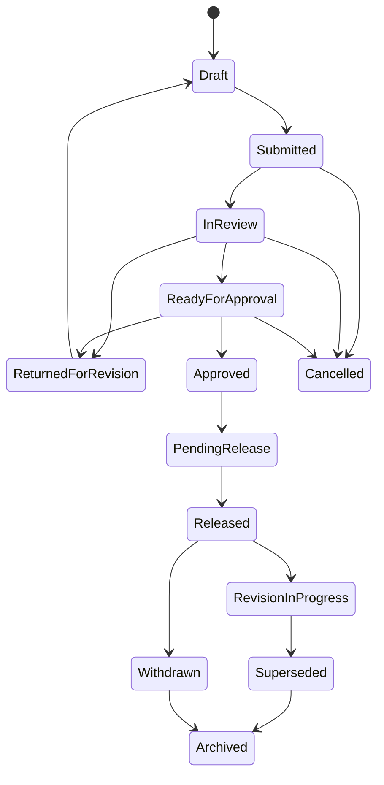

# Configurable Workflow Engine

## 1. Purpose

The workflow engine must let each institution configure who reviews, recommends, approves, releases, or otherwise acts on a document. The engine must not impose one universal approval chain.

## 2. Workflow configuration dimensions

A workflow template may define:
- name and description;
- applicable document type/category;
- organizational scope;
- trigger event;
- ordered or parallel stages;
- stage name and purpose;
- eligible role, user, or organizational unit;
- required action (review, technical review, recommendation, approval, release);
- mandatory or optional stage;
- due date or service target;
- quorum or number of required decisions, if supported;
- rejection and return behavior;
- delegation rules;
- escalation rules;
- whether the author may participate;
- separation-of-duty constraints;
- template version and effective dates.

## 3. Workflow instance rules

- Each submitted document version starts a workflow instance.
- The instance stores the exact workflow template version used.
- The system resolves eligible assignees using current role assignments and organizational scope.
- The system validates authority again when a user acts.
- Decisions are append-only business evidence; corrections should be recorded as subsequent events, not silent edits.
- In-progress instances are not silently changed when a template is edited.
- A workflow can be cancelled only by an authorized actor, with reason and audit event.

## 4. Supported stage patterns

At minimum, design for:
- Sequential review: A then B then C.
- Parallel review: A and B review simultaneously.
- Parallel review followed by final approval.
- Role-based assignment: any eligible member of a role can act.
- Named-user assignment: a specific authorized user acts.
- Organizational assignment: an authorized person in a specified unit acts.
- Optional stage.
- Return for revision and resubmission.
- Final approval followed by a separate release action.

Quorum, substitute reviewers, and advanced conditional routing may be delivered in later phases if approved.

## 5. Decision vocabulary

Use explicit decision types, such as:
- pending
- reviewed
- recommended
- approved
- rejected
- returned_for_revision
- cancelled
- delegated

Do not use one ambiguous "approved" status for every stage.

## 6. Example configurable workflows

### Example A: Department procedure
1. Department Coordinator submits.
2. Department Head reviews.
3. QMS/Document Controller checks document-control requirements.
4. Authorized Approving Authority approves.
5. Document Controller releases.

### Example B: Clinical protocol
1. Clinical owner submits.
2. Department Head reviews.
3. Relevant clinical specialist or committee reviews.
4. Quality review.
5. Authorized clinical/institutional authority approves.
6. Document Controller releases.

These are examples only. The institution must configure and approve its actual authority matrix.

## 7. Workflow state machine

The state machine is a starting point. Final states and allowed transitions must be validated against the approved workflow requirements.
